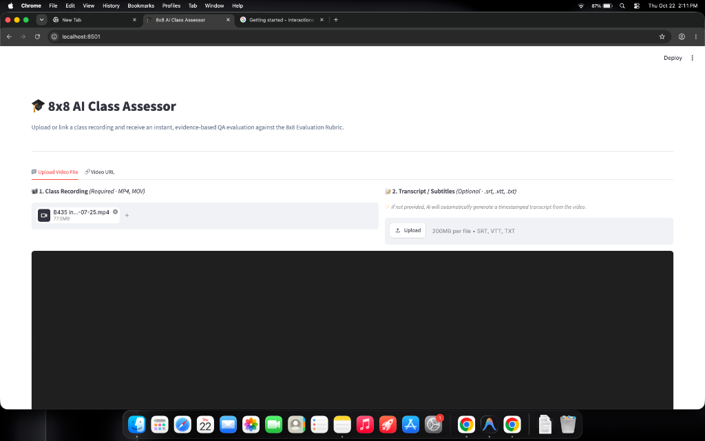
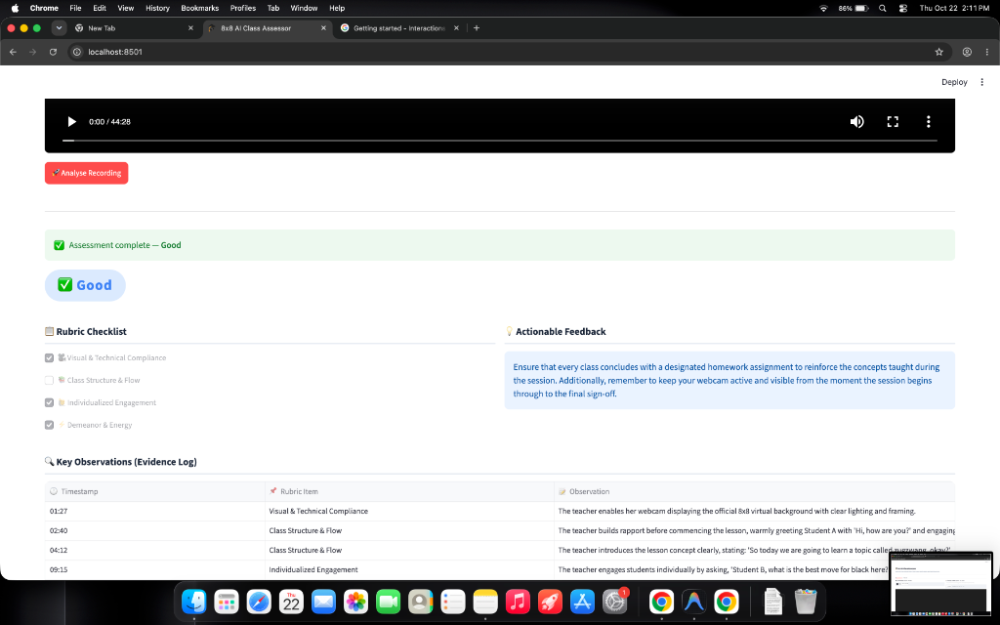
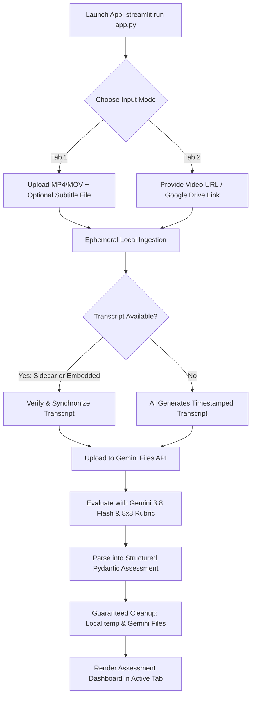

# 🎓 8x8 AI Class Assessor

> **Automated, Evidence-Based Quality Assurance Evaluator for Online Education Recordings**  
> Powered by **Google Gemini 3.8 Flash Multimodal AI**, **Streamlit**, and **Pydantic**.

---

## ⚡ How to Run (Quick Start)

Follow these steps to get the application running locally in under 2 minutes:

### 1. Prerequisites
- **Python 3.10+** installed on your system.
- A **Google Gemini API Key** (obtain a free key from [Google AI Studio](https://aistudio.google.com/apikey)).

### 2. Setup Virtual Environment & Install Dependencies
Open your terminal and navigate to the project root:

```bash
cd /path/to/Reco_Class
```

**macOS / Linux:**
```bash
# Create virtual environment
python3 -m venv .venv

# Activate virtual environment
source .venv/bin/activate

# Install dependencies
pip install -r requirements.txt
```

**Windows (PowerShell):**
```powershell
# Create virtual environment
python -m venv .venv

# Activate virtual environment
.\.venv\Scripts\Activate.ps1

# Install dependencies
pip install -r requirements.txt
```

### 3. Set Up Your API Key
Copy `.env.example` to create your local `.env` file:
```bash
cp .env.example .env
```

Open `.env` in any text editor and add your key:
```dotenv
GEMINI_API_KEY=AIzaSyYourActualGeminiApiKeyHere
```

### 4. Launch the App
Run the Streamlit application:
```bash
streamlit run app.py
```

The app will start and automatically open in your default browser at:
👉 **`http://localhost:8501`**

---

## 📋 Table of Contents
- [How to Run (Quick Start)](#-how-to-run-quick-start)
- [Overview](#-overview)
- [Key Features](#-key-features)
- [Screenshots & User Interface](#-screenshots--user-interface)
- [The 8x8 Evaluation Rubric](#-the-8x8-evaluation-rubric)
- [Application Usage & Workflow](#-application-usage--workflow)
- [Architecture & Tech Stack](#-architecture--tech-stack)
- [Project Directory Structure](#-project-directory-structure)
- [Resilience & Production Engineering](#-resilience--production-engineering)
- [Audit Logging (`log.md`)](#-audit-logging-logmd)
- [Troubleshooting & FAQ](#-troubleshooting--faq)

---

## 🌟 Overview

The **8x8 AI Class Assessor** is an intelligent quality assurance tool designed for online children's education platforms. It automatically evaluates teacher performance, instructional flow, student engagement, and technical compliance by analyzing class video recordings against the standardized **8x8 Evaluation Rubric**.

Instead of producing subjective or generic summaries, the AI assessor acts as a Senior QA Auditor:
- Cross-references exact visual and spoken evidence.
- Verifies dialogue verbatim with timestamps (e.g. `[02:15]`).
- Strictly protects student privacy (referring to learners as "Student A", "Student B", etc.).
- Delivers actionable coaching feedback and an objective performance classification (`Excellent`, `Good`, `Average`, or `Poor`).

---

## 🚀 Key Features

- **Multimodal Video & Audio Understanding**: Analyzes facial expressions, background, lighting, teacher demeanor, tone of voice, and student interactions concurrently.
- **Smart Dialogue & Transcription Support**:
  - **Sidecar File Support**: Upload external `.srt`, `.vtt`, or `.txt` transcripts alongside the video.
  - **Embedded Track Extraction**: Automatically extracts closed captions and subtitle tracks embedded in `.mp4` / `.mov` containers.
  - **AI Auto-Transcription**: If no transcript is provided, the assessor automatically generates a timestamped spoken dialogue transcript before running the QA audit.
  - **Transcript Viewer & Downloader**: View synchronized transcripts directly in an expandable widget and export them with one click.
- **Dual Input Modes with Isolated State**:
  - **📁 Upload Video File**: Direct local file drag & drop supporting video files up to 1 GB.
  - **🔗 Video URL**: Support for direct video URLs and Google Drive sharing links (with automated large-file virus-scan bypass).
  - **Independent Tab Isolation**: Each tab maintains its own evaluation results without leaking data into the other tab.
  - **Persistent Session State with Explicit Clear**: Data is preserved across tab switching and only resets when you click **🗑️ Clear Results**.
- **Evidence-Based Observation Log**: Every rubric decision is backed by timestamped observations quoting the teacher and describing exact actions.
- **Zero Data Retention (Ephemeral Lifecycle)**:
  - Local temporary files are immediately removed from disk after processing.
  - Gemini Files API cloud storage is explicitly deleted (`client.files.delete()`) in a guaranteed `finally` block.
- **Production Resilience**:
  - Implements exponential backoff with randomized jitter to gracefully handle Gemini `503 UNAVAILABLE` (high traffic) and `429` (rate limits).

---

## 📸 Screenshots & User Interface

### 1. Dual Video & Transcript Ingestion
Side-by-side uploaders for the primary class recording and optional subtitle/transcript files (`.srt`, `.vtt`, `.txt`), with integrated video player preview:



### 2. Comprehensive Assessment Dashboard
Evidence-based evaluation output displaying the overall grade badge, 8x8 rubric compliance checklist, actionable pedagogical feedback, and timestamped evidence log:



---

## 📏 The 8x8 Evaluation Rubric

Every submission is evaluated against four mandatory criteria:

| # | Rubric Item | Description | Pass Criteria |
|---|---|---|---|
| 1 | **🎥 Visual & Technical Compliance** | Background, framing, camera, and lighting | Official 8x8 background active, teacher well-lit, webcam continuously on from start to finish. |
| 2 | **📚 Class Structure & Flow** | Lesson pacing and structural progression | Clear introduction, rapport building *before* teaching/revision, and formal homework assigned at the end. |
| 3 | **🙋 Individualized Engagement** | Student interaction quality | Calls upon students individually by name, gives sufficient response wait time (3-5s), avoids collective-only questioning. |
| 4 | **⚡ Demeanor & Energy** | Instructor presence and enthusiasm | Visibly smiling, enthusiastic, encouraging, and maintaining high energy throughout the session. |

### 🏆 Grading Anchors

- **`Excellent`**: Flawless execution across all 4 criteria. High energy, 8x8 background, individual questioning, rapport built, homework assigned.
- **`Good`**: Strong performance with minor gaps (e.g., adhered to structure and background, but missed homework assignment or exhibited slightly lower energy).
- **`Average`**: Meets technical requirements (background, individual questioning) but lacks energetic communication, or experienced minor lighting/clarity issues.
- **`Poor`**: Critical omissions (skipped rapport building, rushed into revision, missed homework, turned off camera, or failed to use the 8x8 background).

---

## 🖥️ Application Usage & Workflow



### Step 1: Select Input Mode
- **📁 Upload Video File**:
  - Drag and drop your `.mp4` or `.mov` file into the recording uploader.
  - *(Optional)* Upload an existing `.srt`, `.vtt`, or `.txt` subtitle/transcript file.
  - Preview the uploaded video directly in the built-in video player.
- **🔗 Video URL**:
  - Paste a public video URL or a Google Drive sharing link (e.g. `https://drive.google.com/file/d/.../view?usp=sharing`).
  - *(Optional)* Upload a sidecar transcript file.

### Step 2: Run Assessment
- Click **🚀 Analyse Recording**.
- The app will:
  1. Download/ingest the video securely into temporary storage.
  2. Extract embedded subtitle tracks or auto-generate a timestamped dialogue transcript with AI.
  3. Upload the video to the Gemini Files API and monitor file processing until active.
  4. Perform multimodal reasoning using `gemini-3.8-flash` with strict JSON schema enforcement (`Assessment`).
  5. Delete the temporary files from both your computer and the Gemini cloud.

### Step 3: Review Results
- **Grade Badge**: High-visibility pill badge with color coding:
  - 🟢 **Excellent** (Green)
  - 🔵 **Good** (Blue)
  - 🟡 **Average** (Amber)
  - 🔴 **Poor** (Red)
- **Transcript Viewer**: Expand to inspect the exact timestamped transcript utilized, with a **💾 Download Transcript (.txt)** button.
- **Rubric Checklist**: Interactive disabled checkboxes reflecting compliance on Visuals, Flow, Engagement, and Energy.
- **Actionable Feedback**: 2–3 targeted, high-impact pedagogical coaching points.
- **Key Observations (Evidence Log)**: An audit log table detailing timestamps, rubric criteria, and exact teacher quotes/actions.

### Step 4: Clear or Switch Tabs
- Click **🗑️ Clear Results** whenever you wish to clear a tab's saved evaluation.
- Switching between tabs does **not** wipe or mix data; each tab keeps its own state until cleared.

---

## 🛠️ Architecture & Tech Stack

- **Frontend / Application Framework**: [Streamlit](https://streamlit.io/) (`>=1.35.0`)
- **Multimodal AI Foundation**: [Google GenAI Python SDK](https://github.com/googleapis/python-genai) (`google-genai >= 1.0.0`)
- **AI Model**: `gemini-3.8-flash`
- **Structured Data Validation**: [Pydantic v2](https://docs.pydantic.dev/) (`pydantic >= 2.0.0`)
- **HTTP / Download Streaming**: [Requests](https://requests.readthedocs.io/) (`requests >= 2.31.0`)
- **Environment Management**: [python-dotenv](https://github.com/theskumar/python-dotenv) (`python-dotenv >= 1.0.0`)

---

## 📁 Project Directory Structure

```text
Reco_Class/
├── app.py                  # Core application: Streamlit UI, Gemini orchestration, transcription, and rubric evaluation
├── requirements.txt        # Pinned Python package dependencies
├── .env.example            # Template for required environment variables (API keys)
├── .env                    # Local environment file (contains your GEMINI_API_KEY — not committed to Git)
├── README.md               # User documentation, quick-start guide, and architectural reference
├── log.md                  # Comprehensive, timestamped application audit log
├── APP.md                  # Original product specification and evaluation prompt instructions
├── PLAN.md                 # Technical implementation plan and architectural milestones
├── assets/
│   └── images/             # Visual documentation screenshots for upload interface & dashboard
├── .streamlit/
│   └── config.toml         # Streamlit server settings (auto-reload on save, headless mode, maxUploadSize)
└── .gitignore              # Ignores .env, virtual environments, caches, and temp artifacts
```

---

## 🛡️ Resilience & Production Engineering

1. **Transient Error Handling (Exponential Backoff)**:
   - High traffic on AI models can periodically trigger `503 UNAVAILABLE` or `429 RESOURCE_EXHAUSTED`.
   - `generate_content_with_backoff` automatically intercepts these errors, applies exponential delay ($2s, 4s, 8s, 16s...$) with randomized jitter, and retries up to 5 times.
2. **Large Google Drive Downloads**:
   - Google Drive returns an HTML virus-scan warning page for files exceeding ~100 MB.
   - The app's URL fetcher detects this warning page, extracts the form confirmation token and UUID, and streams the binary `.mp4` video directly.
3. **Data Privacy & Ephemeral Storage**:
   - Audio/video files uploaded to the app are processed ephemerally.
   - In the `try ... finally` block, the local tempfile is removed with `os.remove()` and the Gemini remote file is destroyed with `client.files.delete()`.
   - The AI evaluation prompt strictly mandates student anonymization (e.g., "Student A").

---

## 📝 Audit Logging (`log.md`)

All operational events are logged to [log.md](file:///Users/shafi/WEE/Reco_Class/log.md) in the project root:
```text
2026-10-22 14:35:10 | INFO  | [UPLOAD] Starting upload of 'lesson_demo.mp4' to Gemini Files API.
2026-10-22 14:35:14 | INFO  | [UPLOAD] File accepted by Gemini. File name: files/abc123xyz
2026-10-22 14:35:18 | INFO  | [TRANSCRIPT] AI transcription completed (1420 chars).
2026-10-22 14:35:19 | INFO  | [INFERENCE] Calling gemini-3.8-flash for file: files/abc123xyz
2026-10-22 14:35:25 | INFO  | [INFERENCE] Assessment received. Grade: Good | Observations: 6
2026-10-22 14:35:26 | INFO  | [CLEANUP] Deleted local temp file: /var/folders/.../tmpabc.mp4
2026-10-22 14:35:27 | INFO  | [CLEANUP] Deleted Gemini file: files/abc123xyz
```

---

## ❓ Troubleshooting & FAQ

### Q: Why do I see "GEMINI_API_KEY is not set"?
**A:** Ensure your `.env` file exists in the project root (alongside `app.py`) and contains `GEMINI_API_KEY=your_key`. Make sure there are no trailing spaces or quotes around the key.

### Q: Why did a Google Drive link fail with "Unexpected Content-Type: text/html"?
**A:** Check the sharing settings of the Google Drive link. The link must be set to **"Anyone with the link can view"**. If the file is private or restricted to a Google Workspace organization, public download requests will be redirected to a Google login page.

### Q: Can I evaluate recordings that do not have an official transcript?
**A:** Yes! If you don't provide a transcript file, the assessor will automatically generate a timestamped transcript using Gemini audio analysis before performing the QA rubric evaluation.

### Q: How do I change the maximum file upload size?
**A:** The upload limit is configured in `.streamlit/config.toml` under `maxUploadSize = 1000` (in megabytes). You can adjust this value to accommodate larger class recordings.

---

## 📄 License

Internal Quality Assurance & Evaluation Tool. Built for 8x8 online education assessment.
